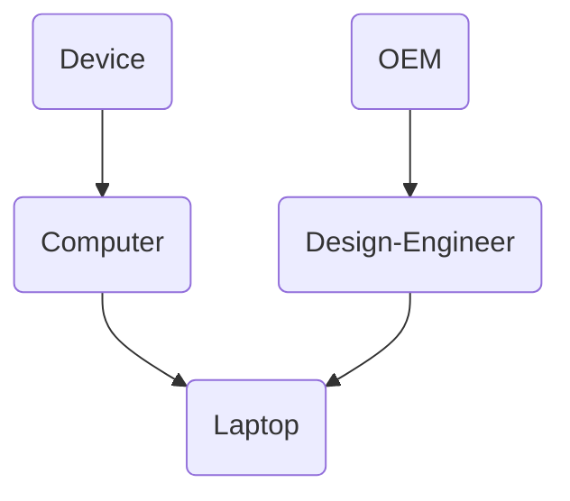

# Add Diagram

Add one Mermaid diagram to a note, so the concept is easier to grasp and its link to other concepts is visible at a glance.

One turn. Design the diagram and write it into the note in the same reply.

## The run

1. Read the note in full. Read nothing else unless a node depends on it.
2. Pick the diagram type using the rule below.
3. Build the block, then check every linked label against the filesystem.
4. Write it into the note, placed as **Where it goes** says.
5. Reply with two lines: which type you picked and why, then the confirmation and the wikilink. The block is in the note — do not paste it back.

If the user hands you a block, skip the design and place it as given.

If the user rejects a diagram you wrote, build the better one and write it over the old one in that same reply.

### Which type

Ask one question of the note: does it mostly fix a thing's **place** among other things, or mostly describe something **happening** in steps?

- Place → **relationship map.** Parent, children, and the concepts it touches. Use `graph TD`.
- Steps → **process flow.** What happens, in order. Use `graph LR`.

When both fit, pick the one the note spends more words on. Say which you picked and why in one line — never silently.

If the note has neither — nothing to relate, nothing that happens in order — say it needs no diagram. An empty diagram is worse than none.

### Building the block

- **Only relationships the note already states.** No new facts, no inferred links, no outside knowledge. If the note does not say it, it does not go in the diagram.
- **Labels are the filename with each word capitalised, hyphens kept** — `Personal-Computer`, `Design-Engineer`, `Supply-Chain`. Acronyms stay upper — `OEM`, `API`. **Never a space.**
- **Node IDs are the filename with hyphens turned to underscores** — `personal_computer(Personal-Computer)`. A bare hyphen in a Mermaid ID collides with `-->` parsing, and an ID cannot hold a space. The ID is never displayed.
- **A node that is a note goes in the `class ... internal-link;` line.** Obsidian builds the link from the node's **displayed text**, not its ID.
- **The note's own node is never in that line.** A link to the note you are already reading does nothing, and reads as broken. Draw the node, leave it unlinked.
- **A node that is not a note gets plain prose** — `Your money`, `Units issued` — and stays out of that line.
- **Every node is rounded** — `id(Label)`, not `id[Label]`. Square brackets only where a label holds a character that breaks the parentheses form, in which case quote it: `id["A, B"]`.
- Never hard-wrap. One line per Mermaid statement, however long.

A diagram for `laptop.md` — note `laptop` is drawn but absent from the `class` line, because it is the note's own subject:

## How Obsidian renders this

Three findings, each learned by breaking it. Do not rediscover them.

### Always `graph`, never `flowchart`

Obsidian wires mermaid links with the selector `[*|class*="internal-link"] > g.label foreignObject > div`. That `>` is a direct-child combinator. Mermaid's `flowchart` renderer nests the label one level deeper than `graph` does, so the selector misses and **no link is created at all** — the diagram renders perfectly and silently does nothing when clicked. Use `graph TD` / `graph LR`.

### Labels keep the hyphen

Obsidian builds the link as `createEl("a", {href: v})` where `v` is the node's **displayed text**, then resolves it by path and basename. That resolution is **case-insensitive but not space-insensitive**, and **it does not consult `aliases` frontmatter**.

- `Design-Engineer` resolves to `design-engineer.md`. Case is forgiven.
- `Design Engineer` does not. Obsidian reports *"Design Engineer is not created yet"*.
- Adding `aliases: [Design Engineer]` does **not** fix it. This was tried and it failed — mermaid links never reach the alias resolver. Do not reach for it again.

So the hyphen is load-bearing, not a style choice. A label with a space is a dead link.

### Centring lives in CSS

If the vault centers diagrams via a CSS snippet (e.g. a `mermaid-center.css` under `.obsidian/snippets/`, enabled under Settings → Appearance → CSS snippets), that is where the centring lives. Obsidian has no markdown-level alignment for a mermaid block, so **never try to centre one from inside the note** — no wrapper `
`, no `%%{init}%%` hack. A left-aligned diagram just means that snippet is not set up, or is not enabled, on that device. Say so; do not edit the block.

## Where it goes

1. Insert the block **bare, with no heading**, directly after the note's opening definition line and before the first bullet or heading.
2. Blank line above and below the block.
3. If the note already has a mermaid block, **replace it**. Never leave two.
4. Change nothing else, in any note — no rewording, no new sections, no tidying.

## Red flags

- Ending the turn with a proposal and no write → the diagram goes in the note, in that turn.
- Asking "shall I add it?" → add it; the user invoked the skill to get it added.
- Redesigning a block the user already handed you → place it as given.
- `flowchart` instead of `graph` → links silently never wire. Swap it.
- A space in a label → dead link. `design_engineer(Design-Engineer)`, never `(Design Engineer)`.
- Adding an `aliases` key to make a spaced label work → it does not work. Use the hyphen.
- A hyphen or space in a node ID → underscores only.
- The note's own subject sitting in the `internal-link` line → remove it, it is a self-link.
- A prose node sitting in the `internal-link` line → remove it from that line.
- A node label you did not check against disk → check it, or make it prose.
- A node naming a concept the note never mentions → remove it.
- Adding a heading above the diagram → remove it, the block sits bare.
- A second mermaid block in one note → replace the first instead.
- Editing any note other than the one getting the diagram → revert it.
